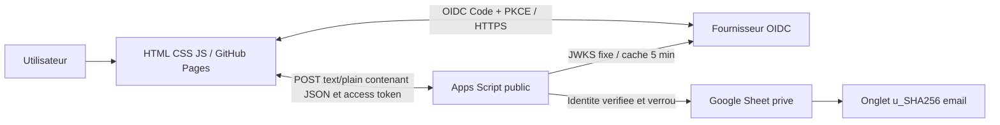
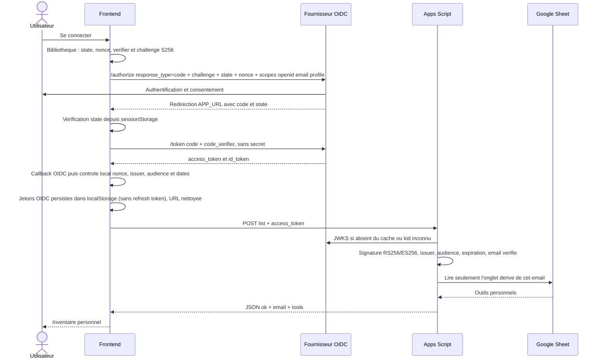
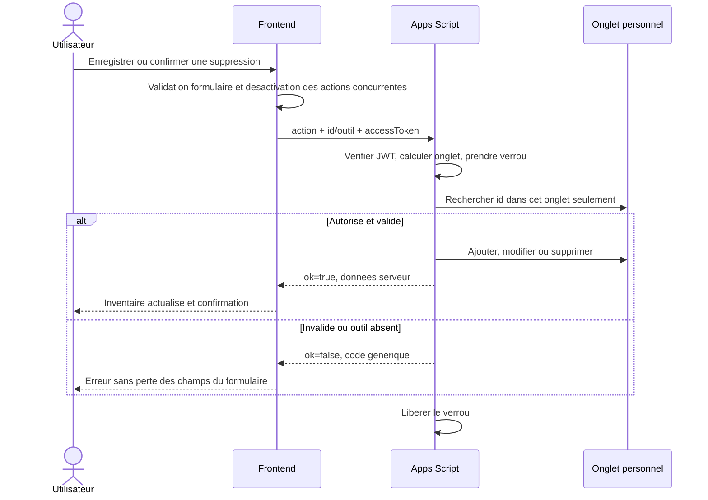

# Fonctionnement et progression

## Perimetre livre

L'utilisateur se connecte, visualise sa boite personnelle, recherche et filtre ses
outils, puis cree, modifie ou supprime un outil apres confirmation. Un outil a un
nom (100 caracteres), une categorie, une description (1000 caracteres), un etat
et une intention de partage. Les listes de categories et d'etats sont fermees
et controlees au serveur. Une description vide est permise.

### Interface et presentation

Le nom du produit affiche dans l'interface est **Toolbox Share**. L'interface
francophone utilise les accents et caracteres propres au francais dans ses textes,
libelles, messages, descriptions et exemples.

La page principale reunit l'identite du produit et la connexion, la navigation
vers l'inventaire, un bandeau d'accueil, le resume de l'inventaire, la recherche
et les filtres, puis les cartes d'outils et les formulaires d'ajout, de
modification et de suppression. Les entrees de navigation « prochaine escale »
signalent des fonctions futures ; elles ne sont pas des vues ou actions actives.
La mention de partage sur une fiche indique une intention de partage uniquement :
elle ne publie pas l'outil dans un catalogue.
La presentation privilegie les commandes et l'inventaire : elle n'ajoute ni
baseline sous le nom du produit, ni fil d'Ariane, ni surtitre ou sous-titre
d'accueil, ni texte generique sur le stockage de l'espace personnel.

L'identite visuelle emploie un fond gris clair, des surfaces gris-vert, des
accents verts et une touche pirate conviviale, notamment dans les textes
d'accueil. La typographie repose sur les polices systeme et les illustrations
d'outils / icones locales existantes ; aucune police, icone ou ressource
graphique n'est chargee depuis un CDN. Cette presentation conserve le frontend
statique HTML/CSS/JavaScript et ne change ni les flux d'authentification ni le
contrat API.

Les libelles visibles sont localises sans modifier les valeurs techniques
transmises au serveur. Par exemple, les categories `Percage`, `Decoupe` et
`A main` restent les valeurs du contrat API et sont affichees « Perçage »,
« Découpe » et « À main ». De meme, `Tres bon` et `Usage` restent les valeurs
stockees, affichees respectivement « Très bon » et « Usagé ». Les controles,
filtres, formulaires et demonstrations suivent cette correspondance.

Apres connexion, l'adresse du compte est affichee de maniere concise dans un
bouton visible egalement sur smartphone. Ce bouton ouvre un menu de compte dont
la seule option active est la deconnexion. En haut du menu, l'adresse complete
est affichee sans troncature ; elle revient a la ligne sur les petits ecrans.
L'adresse du profil OIDC est presentee des le retour de connexion, puis confirmee
par la reponse du backend ; aucune
adresse saisie ni information de profil du navigateur n'autorise une operation.
Un rechargement reprend la session
OIDC persistante tant que l'access token et l'ID token sont valides. A expiration,
la session locale est effacee et une nouvelle connexion est requise. Les outils
reels restent dans Sheets.

Sans configuration, une demonstration isolee fonctionne uniquement en memoire,
sans requete API, sans compte et sans sauvegarde navigateur. Les six exemples
reviennent au rechargement. Elle n'est pas publiee par le workflow de production.
La demonstration utilise la meme interface localisee et les memes libelles
conviviaux que l'inventaire personnel, tout en restant explicitement distinguee
de l'espace connecte par un badge « Démonstration ». L'interface n'affiche pas de
libelle « Espace personnel » ni de detail de stockage de l'inventaire.

## Composants



## Connexion et gestion des jetons



L'ID token n'est jamais utilise comme autorisation d'API. Les jetons ne sont ni
des parametres d'URL ni des cookies. L'access token et l'ID token sont conserves
dans `localStorage` pour reprendre la session apres rechargement ; le stockage
OIDC retire tout refresh token avant ecriture. Les donnees transitoires PKCE
(state, nonce, code_verifier et URL de retour) restent dans `sessionStorage` et
sont supprimees lorsqu'elles sont consommees. L'application n'effectue aucun
rafraichissement silencieux. Le serveur controle l'expiration a chaque operation,
independamment de l'horloge et des controles du frontend.

Seuls les scopes OIDC `openid email profile` sont demandes. Aucun scope
applicatif n'est necessaire et le backend n'exige pas de claim `scope` dans
l'access token. L'autorisation du CRUD personnel repose sur l'audience API
validee et sur l'onglet derive de l'e-mail verifie, pas sur un scope metier.

## CRUD personnel



Le verrou couvre lecture et ecriture. La creation emet un nouvel UUID. Une
modification conserve `createdAt`, remplace `updatedAt` et les champs autorises.
Les horodatages sont au format ISO UTC. Le dernier enregistrement gagne : pas de
gestion des conflits multi-onglets ni d'idempotence dans cette version.
En cas de reseau coupe pendant une mutation, son resultat peut etre inconnu :
actualiser avant de reessayer, afin d'eviter une creation en double.

## Contrat de l'API

Toutes les operations : `POST API_URL`, `Content-Type: text/plain;charset=UTF-8`,
corps JSON. `accessToken` est present a chaque appel. Aucun en-tete Authorization.

| Action | Autres champs | `data` en cas de succes |
| --- | --- | --- |
| `list` | Aucun | `{email, tools: [...]}` |
| `create` | `tool` | Outil complet avec UUID et dates |
| `update` | `id`, `tool` | Outil complet mis a jour |
| `delete` | `id` | `{id}` |

Exemple de `tool` :

```json
{"name":"Perceuse","category":"Percage","description":"18 V","condition":"Bon","shared":false}
```

Enveloppe : `{"ok":true,"data":...}` ou `{"ok":false,"error":"UNAUTHORIZED"}`.
Erreurs : `BAD_REQUEST`, `UNAUTHORIZED`, `FORBIDDEN`, `NOT_FOUND`, `BUSY`,
`CONFIGURATION`, `INTERNAL`. Le serveur ne renvoie ni stack, ni JWT, ni detail
cryptographique. Les erreurs HTTP et les erreurs applicatives sont distinctes.

## Etapes suivantes (non implementees)

| Etape | Fonctionnalite | Decisions et criteres avant livraison |
| --- | --- | --- |
| 2 | Profil : nom affiche, zone geographique, moyens de contact | ADR schema et visibilite, consentement de publication, validation des liens de contact, ACL de modification du profil |
| 3 | Catalogue des outils partages des autres utilisateurs | ADR index partage, filtrage serveur sur `shared`, exclusion des champs prives, pagination et quotas ; jamais lecture libre de tous les onglets |
| 4 | Demande d'emprunt au proprietaire | ADR demandes : proprietaire/demandeur, dates, etats, permissions, prevention spam ; contact uniquement selon les moyens consentis |
| 5 | Suivi des prets et notifications | Accepter/refuser/annuler, retour du materiel, disponibilite et concurrence ; pas de notification sans consentement |

Flux cible pour les etapes 3 et 4 :


Ces vues ne sont pas navigables dans cette livraison. Les libelles « Prochaine
etape » ne correspondent pas a des boutons actifs. Avant toute extension, faire
approuver les changements d'architecture et actualiser ADR, contrats et recette.