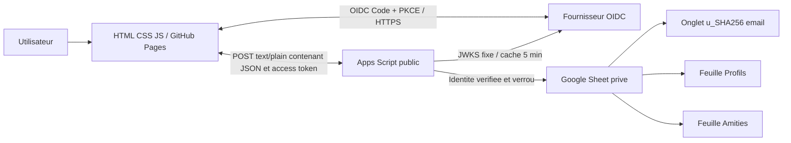
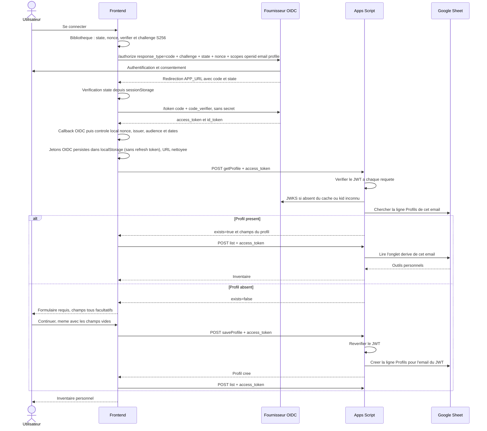
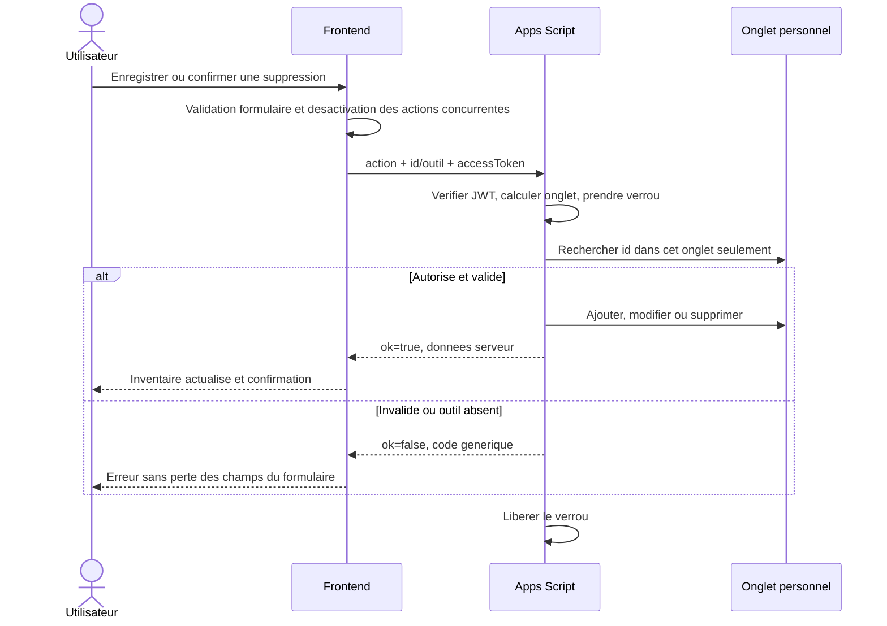
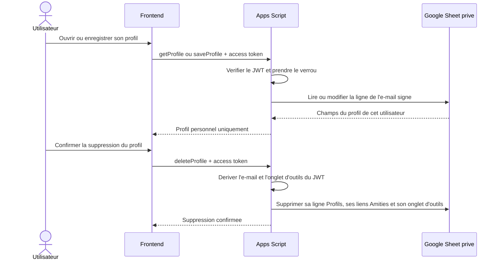
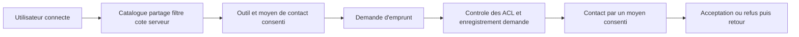

# Fonctionnement et progression

## Perimetre livre

L'utilisateur se connecte, visualise sa boite personnelle, recherche et filtre ses
outils, puis cree, modifie ou supprime un outil apres confirmation. Un outil a un
nom (100 caracteres), une categorie, une description (1000 caracteres), un etat
et un choix de partage avec ses amis. Les listes de categories et d'etats sont
fermees et controlees au serveur. Une description vide est permise.

### Interface et presentation

Le nom du produit affiche dans l'interface est **Toolbox Share**. L'interface
francophone utilise les accents et caracteres propres au francais dans ses textes,
libelles, messages, descriptions et exemples.

La page principale reunit l'identite du produit et la connexion, la navigation
vers l'inventaire, un bandeau d'accueil, le resume de l'inventaire, la recherche
et les filtres, puis les cartes d'outils et les formulaires d'ajout, de
modification et de suppression. La navigation comprend aussi « Les outils du
quartier » pour consulter les outils partages des amis.
La mention de partage sur une fiche indique que l'outil est visible par les amis
acceptes dans « Les outils du quartier ».
La presentation privilegie les commandes et l'inventaire : elle n'ajoute ni
baseline sous le nom du produit, ni fil d'Ariane, ni surtitre ou sous-titre
d'accueil, ni texte generique sur le stockage de l'espace personnel.

L'identite visuelle emploie un fond gris clair, des surfaces gris-vert, des
accents verts et une touche pirate conviviale, notamment dans les textes
d'accueil. La typographie repose sur les polices systeme et les illustrations
d'outils / icones locales existantes ; aucune police, icone ou ressource
graphique n'est chargee depuis un CDN. Cette presentation conserve le frontend
statique HTML/CSS/JavaScript et ne change ni les flux d'authentification ni le
contrat API.

Les libelles visibles sont localises sans modifier les valeurs techniques
transmises au serveur. Par exemple, les categories `Percage`, `Decoupe` et
`A main` restent les valeurs du contrat API et sont affichees « Perçage »,
« Découpe » et « À main ». De meme, `Tres bon` et `Usage` restent les valeurs
stockees, affichees respectivement « Très bon » et « Usagé ». Les controles,
filtres, formulaires et demonstrations suivent cette correspondance.

La barre de titre « Toolbox Share » est distincte d'une rangée de commandes
placée juste en dessous, afin d'aérer l'interface. Cette rangée regroupe le
bouton « Mon espace » et le bouton affichant l'adresse du compte. Le premier
affiche ou masque le menu latéral, qui regroupe la boîte à outils et les outils
du quartier ; sur mobile, il ouvre ce menu en tiroir. Le bouton de compte ouvre
un menu avec les actions « Mes amis », « Mon profil » et la déconnexion. En haut
du menu, l'adresse complète est affichée sans troncature ; elle revient à la
ligne sur les petits écrans.
« Mon profil » ouvre une page integree a l'ecran principal, pas une modale. La
suppression du profil se trouve sur cette page, aupres des informations de
compte, et reste protegee par une confirmation. Lors d'un echange avec le
backend, la page reste affichee avec un indicateur anime et un texte d'etat
adapte a l'action ; l'indicateur disparait lorsque la reponse est recue.
L'adresse du profil OIDC est presentee des le retour de connexion, puis confirmee
par la reponse du backend ; aucune
adresse saisie ni information de profil du navigateur n'autorise une operation.
Un rechargement reprend la session
OIDC persistante tant que l'access token et l'ID token sont valides. A expiration,
la session locale est effacee et une nouvelle connexion est requise. Les outils
reels restent dans Sheets. A chaque connexion, l'application verifie le profil
dans Sheets avant de charger l'inventaire. Si la ligne est absente, l'utilisateur
doit creer son profil pour continuer, mais peut enregistrer les trois champs
vides ; aucun autre ecran fonctionnel n'est accessible avant cette creation.

Sans configuration, une demonstration isolee fonctionne uniquement en memoire,
sans requete API, sans compte et sans sauvegarde navigateur. Les six exemples
reviennent au rechargement. Elle n'est pas publiee par le workflow de production.
La demonstration utilise la meme interface localisee que l'inventaire personnel,
mais conserve les libelles « Partage prévu » : son choix de partage ne publie
aucune donnee et n'est pas transmis a un backend. Les fonctions sociales sont
masquees. Elle reste explicitement distinguee de l'espace connecte par un badge
« Démonstration ». L'interface n'affiche pas de libelle « Espace personnel » ni
de detail de stockage de l'inventaire.

## Composants



## Connexion et gestion des jetons



L'ID token n'est jamais utilise comme autorisation d'API. Les jetons ne sont ni
des parametres d'URL ni des cookies. L'access token et l'ID token sont conserves
dans `localStorage` pour reprendre la session apres rechargement ; le stockage
OIDC retire tout refresh token avant ecriture. Les donnees transitoires PKCE
(state, nonce, code_verifier et URL de retour) restent dans `sessionStorage` et
sont supprimees lorsqu'elles sont consommees. L'application n'effectue aucun
rafraichissement silencieux. Le serveur controle l'expiration a chaque operation,
independamment de l'horloge et des controles du frontend.

Seuls les scopes OIDC `openid email profile` sont demandes. Aucun scope
applicatif n'est necessaire et le backend n'exige pas de claim `scope` dans
l'access token. L'autorisation du CRUD personnel repose sur l'audience API
validee et sur l'onglet derive de l'e-mail verifie, pas sur un scope metier.

## CRUD personnel



Le verrou couvre lecture et ecriture. La creation emet un nouvel UUID. Une
modification conserve `createdAt`, remplace `updatedAt` et les champs autorises.
Les horodatages sont au format ISO UTC. Le dernier enregistrement gagne : pas de
gestion des conflits multi-onglets ni d'idempotence dans cette version.
En cas de reseau coupe pendant une mutation, son resultat peut etre inconnu :
actualiser avant de reessayer, afin d'eviter une creation en double.

## Profil personnel

La page « Mon profil », ouverte depuis le menu du compte, permet de consulter et
modifier les champs nom et prenom,
numero de telephone et adresse physique. Chaque champ est facultatif et peut
etre vide individuellement ; une sauvegarde avec les trois champs vides conserve
une ligne identifiee par l'e-mail dans `Profils`. La feuille comporte les colonnes
`email`, `nom prénom`, `numéro de téléphone` et `adresse physique`. Elle reste
privee et n'est jamais exposee a un compte sans amitie acceptee. Les trois champs
de profil sont visibles par les amis acceptes.

Lorsqu'aucune ligne de profil n'existe a la connexion, un formulaire bloque
l'acces a l'inventaire. Le bouton « Continuer » cree le compte applicatif meme
si l'utilisateur n'a rien renseigne. Cette regle s'applique egalement aux
utilisateurs qui possedent deja un onglet d'outils mais n'ont pas encore de
ligne dans `Profils`.

Le navigateur n'envoie pas d'e-mail ni de numero de ligne pour autoriser ces
operations. Apps Script derive l'e-mail de l'access token verifie, puis lit ou
modifie exclusivement la ligne correspondante. Nom, telephone et adresse sont
limites respectivement a 120, 50 et 500 caracteres ; les caracteres de controle,
dont les retours a la ligne, sont refuses. Les valeurs susceptibles d'etre
interpretees comme formules Sheets sont protegees comme texte.

« Supprimer mon profil » ouvre une confirmation qui precise que l'action efface
la ligne de profil, toutes ses demandes/liens d'amitie et l'onglet contenant
tous les outils de l'utilisateur.
L'action est irreversible depuis l'application. Le jeton OIDC et le compte chez
le fournisseur ne sont pas supprimes ; un utilisateur toujours connecte revient
au formulaire de creation de profil. Il ne peut ni lister ni recreer ses outils
avant d'avoir cree un nouveau profil. La liste vide ne recree pas l'onglet
d'outils ; celui-ci est recree seulement lors d'un nouvel ajout apres creation
du profil.



## Amis et outils du quartier

« Mes amis » est accessible depuis le menu du compte. La navigation laterale
« Mon espace » expose la boîte à outils et les outils du quartier ; sur mobile,
un bouton « Mon espace » ouvre ce menu depuis le bandeau superieur. Ces
fonctions sont absentes de la demonstration en memoire.

La page « Mes amis » comporte trois onglets :

- « Amis » affiche les relations acceptees et les champs de profil nom/prenom,
  telephone et adresse physique de chaque ami. Ces champs ne sont retournes
  qu'apres acceptation.
- « Demandes envoyees » affiche uniquement l'e-mail des destinataires en attente,
  sans leurs informations de profil ; le demandeur peut resilier une demande.
- « Demandes recues » affiche uniquement l'e-mail du demandeur et permet au
  destinataire, et a lui seul, d'accepter ou de refuser. Chacun des deux
  participants peut aussi resilier cette demande.
- « Amis » permet de rompre une amitie acceptee depuis une confirmation. La
  rupture retire l'acces reciproque aux profils et aux outils partages ; une
  nouvelle demande devra etre acceptee pour redevenir amis.

Le bouton « Ajouter un ami » ouvre une saisie d'e-mail. Seul un compte ayant deja
un profil peut recevoir une demande. Pour ne pas exposer l'existence des comptes,
l'interface confirme de maniere generique qu'une demande a ete transmise si
l'adresse correspond a un compte actif ; les doublons, demandes croisees et
adresses sans compte ne creent pas de seconde ligne et ne sont pas distingues
dans la reponse. L'auto-demande et les adresses invalides sont refusees.

La feuille privee `Amities` contient une ligne par paire, avec les en-tetes
`email_1`, `email_2`, `demandeur`, `statut`. Les deux e-mails sont normalises et
tries en ordre croissant ; le demandeur reste identifie. Le statut vaut `en
attente` ou `accepté`. Une acceptation met a jour le statut ; un refus supprime
la ligne. Le demandeur ou le destinataire peut resilier une demande en attente ;
chacun peut aussi supprimer la relation acceptee. Dans les deux cas, la ligne
est supprimee. Une demande croisee ne change pas la demande originale : son
destinataire doit la traiter.

Lorsqu'une demande recue est en attente, un point rouge apparait a cote de
l'adresse du compte sur la page d'accueil. A l'ouverture du menu du compte, ce
voyant disparait de l'adresse et apparait a cote de « Mes amis ». Dans la page
amis, le point est egalement visible sur l'onglet « Demandes recues ». L'etat est
charge a la connexion puis actualise a l'ouverture ou par le bouton
d'actualisation de la page amis. Il n'y a ni notification push ni polling en
arriere-plan.

La page « Les outils du quartier » presente sous forme de cartes les outils
`shared=true` de tous les amis acceptes. Recherche, categorie et etat peuvent
etre filtres ; le nom et l'e-mail du proprietaire sont affiches. Les outils
`shared=false` ne sont jamais retournes. Modifier le partage d'un outil a
`false` le retire du catalogue a la prochaine actualisation.

La feuille est creee automatiquement par Apps Script avec les en-tetes definis
ci-dessus. La suppression confirmee d'un profil retire aussi toutes les demandes
et relations de l'utilisateur, en plus de sa ligne de profil et de son onglet
d'outils.

## Contrat de l'API

Toutes les operations : `POST API_URL`, `Content-Type: text/plain;charset=UTF-8`,
corps JSON. `accessToken` est present a chaque appel. Aucun en-tete Authorization.

| Action | Autres champs | `data` en cas de succes |
| --- | --- | --- |
| `list` | Aucun | `{email, tools: [...]}` |
| `create` | `tool` | Outil complet avec UUID et dates |
| `update` | `id`, `tool` | Outil complet mis a jour |
| `delete` | `id` | `{id}` |
| `getProfile` | Aucun | `{exists, name, phone, address}` pour l'e-mail du JWT |
| `saveProfile` | `profile: {name, phone, address}` | Profil sauvegarde |
| `deleteProfile` | Aucun | `{deleted: true}` apres suppression de la ligne de profil, des relations et de l'onglet d'outils |
| `getFriendStatus` | Aucun | `{incomingCount}` pour afficher le point rouge |
| `listFriends` | Aucun | `{friends: [{email, name, phone, address}], sent: [{email}], received: [{email}]}` |
| `sendFriendRequest` | `email` | `{submitted: true}` generique, sans confirmer l'existence du compte cible |
| `respondFriendRequest` | `email` du demandeur, `decision: "accept" ou "decline"` | `{status: "accepté" ou "refusé"}` |
| `removeFriendship` | `email` de l'autre participant | `{removed: true}` ; supprime une demande ou une amitie si l'acteur JWT est l'un des deux participants |
| `listNeighborhoodTools` | Aucun | `{tools: [...]}` ; outils `shared=true` des amis acceptes uniquement |

Les actions `list`, `create`, `update`, `delete` et les actions sociales
repondent `PROFILE_REQUIRED` si la ligne de profil de l'e-mail signe n'existe pas.

Exemple de `tool` :

```json
{"name":"Perceuse","category":"Percage","description":"18 V","condition":"Bon","shared":false}
```

Enveloppe : `{"ok":true,"data":...}` ou `{"ok":false,"error":"UNAUTHORIZED"}`.
Erreurs : `BAD_REQUEST`, `UNAUTHORIZED`, `FORBIDDEN`, `NOT_FOUND`, `BUSY`,
`CONFIGURATION`, `PROFILE_REQUIRED`, `INTERNAL`. Le serveur ne renvoie ni stack,
ni JWT, ni detail cryptographique. Les erreurs HTTP et les erreurs applicatives
sont distinctes.

## Etapes suivantes (non implementees)

| Etape | Fonctionnalite | Decisions et criteres avant livraison |
| --- | --- | --- |
| 1 | Demande d'emprunt au proprietaire | ADR demandes : proprietaire/demandeur, dates, etats, permissions, prevention spam ; contact uniquement selon les moyens consentis |
| 2 | Suivi des prets et notifications | Accepter/refuser/annuler, retour du materiel, disponibilite et concurrence ; pas de notification sans consentement |

Flux cible pour les etapes 3 et 4 :



Les demandes d'emprunt et le suivi des prets ne sont pas navigables dans cette
livraison. Avant toute nouvelle extension, faire approuver les changements
d'architecture et actualiser ADR, contrats et recette.